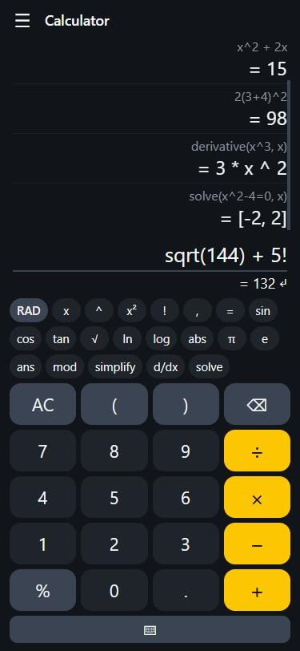
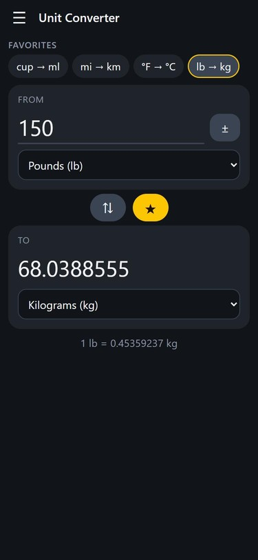
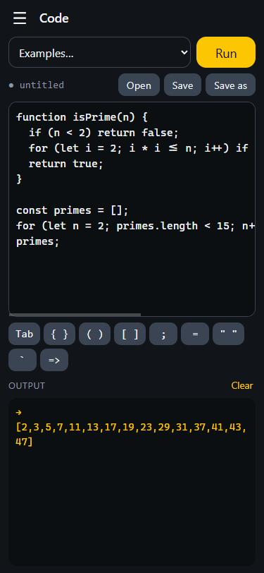
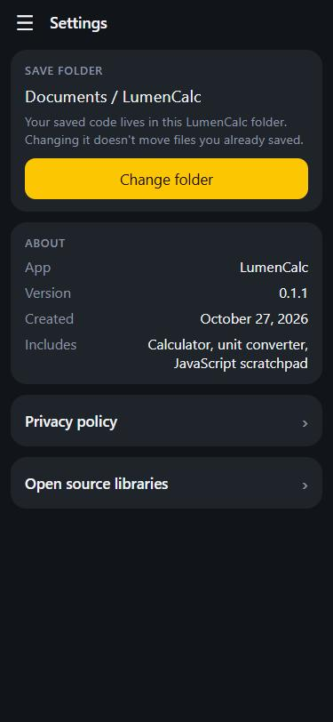

<p align="center">
  
</p>

<h1 align="center">LumenCalc</h1>

A calculator for Android and the browser, built with plain HTML, CSS and JavaScript and wrapped for Android with [Capacitor](https://capacitorjs.com).

**Version 0.1.3.** Early release. The web app is tested in the browser; the Android build, including saving files to `Documents/LumenCalc`, has not been tested on a real device yet.

| Calculator | Unit converter | Code | Settings |
| :---: | :---: | :---: | :---: |
|  |  |  |  |

*Screenshots are the browser build at phone size.*

## What it does

- **Calculator.** Type full expressions with parentheses: `2(3+4)^2`, `5!`, `sqrt(16)`, `sin(pi/2)`. Variables (`x = 5`), your own functions (`f(t) = t^2 + 1`) and `ans`. Algebra with `simplify(2x+3x)`, `derivative(x^3, x)` and `solve(x^2-4=0, x)` (polynomials up to degree 3). Radians or degrees.
- **Unit converter.** Length, mass, temperature, volume, area, speed, time, data, energy, power, pressure and angle. Pick a unit and the "to" list only offers compatible units. Tap the star to save a conversion to a favorites list at the top of the page.
- **Inflation.** What money was worth in another year, using bundled US CPI-U data for 1913-2024 (works offline), or what an amount becomes at a steady yearly rate.
- **Code.** A JavaScript scratchpad that runs in a sandboxed worker with a 5 second limit. Save and open files in a `LumenCalc` folder.
- **Settings.** Choose the save folder, version info, privacy policy and open source licenses.

Everything runs on the device. There are no accounts, analytics or network requests.

## Run it in the browser

```bash
npm install
npm run dev
```

Then open http://localhost:5173. Edits to `www/` reload automatically.

Saving to a chosen folder works in Chrome and Edge. Other browsers download files instead.

## Build the Android app

You need Node, JDK 17 and the Android SDK.

```bash
npm install
npm run icons          # only if you change assets/icon-source.webp
npx cap sync android
cd android
./gradlew assembleDebug
```

The APK lands in `android/app/build/outputs/apk/debug/`. On Android, saved code goes to `Documents/LumenCalc` (or the app's private storage if Android refuses).

## Tests

```bash
npm test
```

Six suites, no test framework needed:

| File | Covers |
| --- | --- |
| `test.js` | Expression engine: precedence, functions, algebra, number formatting |
| `test-units.js` | Unit conversions, including every unit pair round-tripping |
| `test-inflation.js` | Inflation maths: CPI data coverage, adjusting between years, steady-rate growth |
| `test-files.js` | Save/open storage backends (folder, Android, download) |
| `test-ui.js` | The real `index.html` driven in jsdom: keypad, menu, converter and favorites, Code view, Save/Open and Settings on all three storage backends |
| `test-release.js` | Release hygiene: one version everywhere, no garbled text, every script and menu entry wired up |

The Android file API is mocked to match the real bridge, which was checked on an emulator.

## Layout

| Path | What it is |
| --- | --- |
| `www/` | The app itself (HTML, CSS, JS) |
| `www/calc.js` | Expression engine on top of [math.js](https://mathjs.org) |
| `www/units.js` | Unit conversion |
| `www/files.js` | Save/open storage: folder, Android, or download |
| `scripts/` | `vendor.js` (copies math.js and writes the license list), `icons.js` (builds app icons) |
| `android/` | The Capacitor Android project |

## License

No license has been chosen yet, so all rights are reserved for now. Third-party libraries keep their own licenses, listed in the app under Settings.
